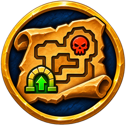

<p align="center"></p>

# Beester's Dungeon Maps

A World of Warcraft: Forever addon that puts dungeon and raid entrances on your world map, shows dungeon maps with their bosses, and lists every dungeon's quests in the map's quest panel.

It is built to look and feel like the game's own interface: it uses the world map's own pin system, the game's tooltips and the game's Settings window.

## Status

**Version 0.2.0 (test build):**
- Dungeon and raid entrance pins on zone and continent maps, with tooltips.
- Dungeon maps inside the game's Map & Quest Log window, for every dungeon and raid: the classic maps that are still in the game files, and Santiago Reyes's maps for the new Forever dungeons.
- Boss icons with each boss's loot.
- Open a dungeon map by clicking its entrance, from the map's top bar (World › Kalimdor › Durotar › Dungeons), or just open your map inside the dungeon.

Coming next:
- The dungeon quest panel and quest details
- Bosses you've killed this run, crossed out

## Installing

1. Download `BeestersDungeonMaps-<version>.zip` from the [Releases page](../../releases).
2. Open your World of Warcraft folder and go to `_forever_\Interface\AddOns`.
   (Usually `C:\Program Files (x86)\World of Warcraft\_forever_\Interface\AddOns`.)
3. Unzip the file there. You should now have a folder called `BeestersDungeonMaps` inside `AddOns`.
4. Start the game. On the character screen, click **AddOns** and make sure **Beester's Dungeon Maps** is ticked.

To update: delete the old `BeestersDungeonMaps` folder, then unzip the new one. Your settings are kept.

## Using it

- Open your world map: dungeon and raid entrances show on zone and continent maps. Hover one for its level range, click it to open the dungeon's map.
- Inside a dungeon, just open your map. `/bdm map` does the same.
- Right-click a dungeon map to go back to the normal map.
- `/bdm` opens the options. If another addon already uses `/bdm`, use `/beesterdm`.
- `/bdm status` prints the game version, the data version and the map you are on. Handy when reporting a problem.
- `/bdm probe` prints what the game supports (map frames, icons, dungeon map art). Run it once outside and once inside a dungeon when reporting map problems.

## Works with Questie

Beester's Dungeon Maps does not need Questie and does not read Questie while you play. It ships its own small copy of the data it needs, built from QuestieDB. It does not change Questie's frames or settings, so the two can run side by side. If you do see an error with both installed, please open an issue with the error text.

## Data and credits

- Entrance coordinates: [QuestieDB](https://github.com/Questie/QuestieDB) (GPL-3.0), Forever data. `tools/build_data.py` turns it into `BeestersDungeonMaps/Data/Entrances.lua`. A GitHub Action rebuilds it every day until December 23, 2026, then every Monday, and publishes a new release whenever the data changed.
- Dungeon quests, lead-in chains, quest givers, quest items and reward items: QuestieDB's Forever data with all its corrections applied, through QuestieDB's own loader (`tools/build_quests.py` → `BeestersDungeonMaps/Data/Quests.lua`). Not shown in game yet; the quest panel comes next.
- Quest text (description, objectives with counts) and rewards (choice items, fixed items, money): the [CMaNGOS Classic database](https://github.com/cmangos/classic-db) (GPL-3.0), `tools/build_quest_text.py` → `BeestersDungeonMaps/Data/QuestText.lua`. Quests new in WoW Forever aren't in it and show QuestieDB's objective line instead. Quest text is © Blizzard Entertainment.
- Dungeon bosses and their order: the WoW Forever client's own DungeonEncounter table, read from [wago.tools](https://wago.tools) (`tools/build_bosses.py` → `BeestersDungeonMaps/Data/Bosses.lua`), with each boss's loot from QuestieDB. Not shown in game yet; boss pins come with the dungeon maps.
- Item tooltips for items the game hasn't loaded yet: the WoW Forever client's own item tables, read from [wago.tools](https://wago.tools) (`tools/fetch_game_items.py`, `tools/build_game_tooltips.py`); items Forever didn't change use the [CMaNGOS Classic database](https://github.com/cmangos/classic-db)'s item stats (`tools/build_classic_tooltips.py`). Written to `BeestersDungeonMaps/Data/LootTooltips.lua` by `tools/fetch_loot_tooltips.py`.
- Instance list and level ranges: `tools/instances.json` (our own). New Forever dungeons missing from QuestieDB are listed there.
- Dungeon maps for the old dungeons: the classic dungeon map images that still ship in the WoW Forever client. The addon only refers to them by file ID; it doesn't include them. List in `tools/dungeon_maps.json`.
- Dungeon maps for the new Forever dungeons: Santiago Reyes (Atlas de Azeroth: Forever), watermarked, used with permission. `tools/build_maps.py` turns them into game textures.
- Boss positions: the Dungeon Journal's map positions for the same map images, from retail (`tools/journal_positions.json`) and from Cataclysm Classic for the original bosses of dungeons that were rebuilt later (`tools/fetch_cata_positions.py`).

World of Warcraft and Blizzard Entertainment are trademarks or registered trademarks of Blizzard Entertainment, Inc. This addon is not made or endorsed by Blizzard.

## For developers

```
python3 tools/build_data.py /path/to/QuestieDB   # rebuild entrance data
python3 tools/build_quests.py /path/to/QuestieDB # rebuild quest data (needs lupa)
python3 tools/build_bosses.py /path/to/QuestieDB # rebuild bosses (fetches wago.tools; or pass a CSV)
python3 tools/build_maps.py                      # rebuild dungeon map data and textures (needs numpy, pillow)
pip install lupa && python3 tools/test_addon.py  # run the checks
./tools/package.sh                               # build the zip into dist/
```

## License

GNU General Public License v3.0. See `LICENSE`.
